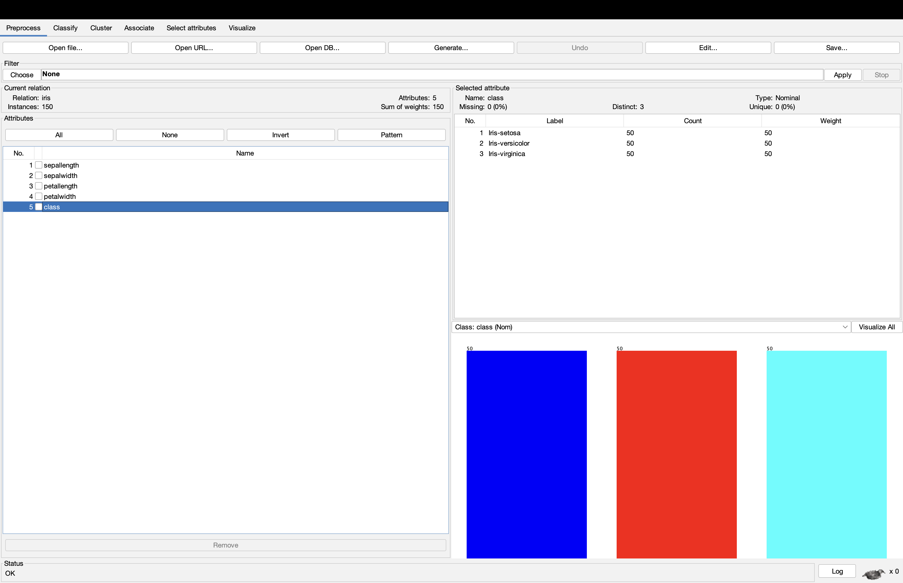
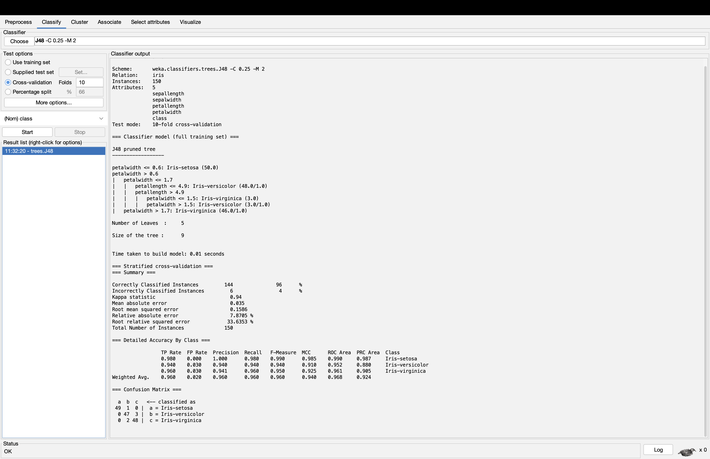
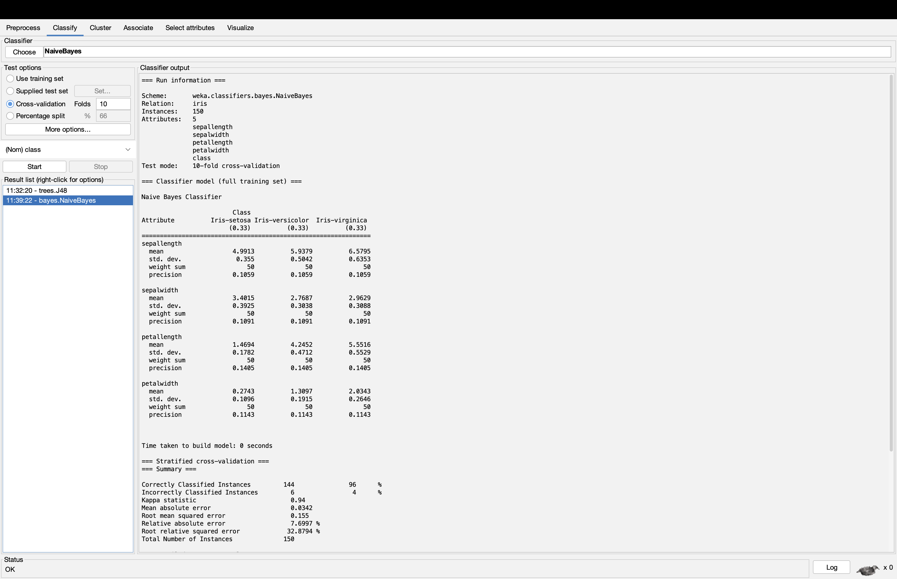
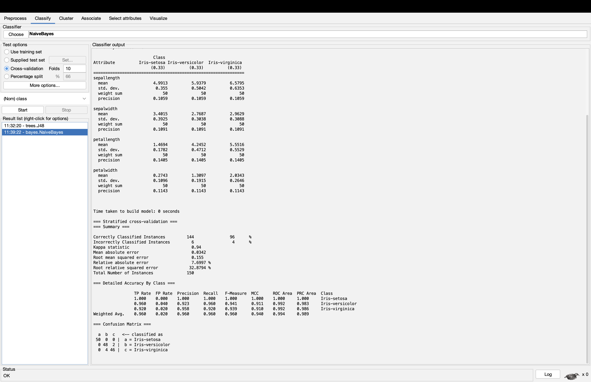

# WEKA Classification Assignment 01

## Objective
Classify Iris flowers using J48 Decision Tree and NaiveBayes in WEKA.

## Dataset
- Dataset: Iris
- Instances: 150
- Predictor attributes: 4
- Target attribute: class
- Classes: Iris-setosa, Iris-versicolor, Iris-virginica
- Missing values: 0

## Experimental Setup
- Software: WEKA 3.8.7
- Evaluation: 10-fold cross-validation
- Random seed: 1
- Models: J48 and NaiveBayes
- Model settings: Defaults

## Results

Results for J48 and NaiveBayes are presented below, including
classification accuracy, weighted F1 score, and confusion matrices.

## Screenshots

### Dataset

### J48 evaluation

### NaiveBayes evaluation

## J48 Results

- Classifier: J48 (default settings, C=0.25, M=2)
- Evaluation: 10-fold cross-validation
- Random seed: 1
- Correctly classified: 144/150 (96.00%)
- Incorrectly classified: 6/150 (4.00%)
- Weighted F1 score: 0.960

### J48 Confusion Matrix

| Actual class | Iris-setosa | Iris-versicolor | Iris-virginica |
|---|---:|---:|---:|
| Iris-setosa | 49 | 1 | 0 |
| Iris-versicolor | 0 | 47 | 3 |
| Iris-virginica | 0 | 2 | 48 |

### J48 Interpretation

The model correctly classified 144 of 150 instances. The main confusion occurred between Iris-versicolor and Iris-virginica, with three versicolor instances classified as virginica and two virginica instances classified as versicolor. One setosa instance was classified as versicolor.

One decision rule in the displayed full-data tree is: if petal width is less than or equal to 0.6, classify the flower as Iris-setosa. The displayed full-data tree is separate from the models fitted within cross-validation.

## NaiveBayes Results

- Classifier: NaiveBayes (default settings)
- Evaluation: 10-fold cross-validation
- Random seed: 1
- Correctly classified: 144/150 (96.00%)
- Incorrectly classified: 6/150 (4.00%)
- Weighted F1 score: 0.960

### NaiveBayes Confusion Matrix

| Actual class | Iris-setosa | Iris-versicolor | Iris-virginica |
|---|---:|---:|---:|
| Iris-setosa | 50 | 0 | 0 |
| Iris-versicolor | 0 | 48 | 2 |
| Iris-virginica | 0 | 4 | 46 |

## Model Comparison

Both J48 and NaiveBayes achieved 96.00% accuracy and a weighted F1 score of 0.960 on the Iris dataset using 10-fold cross-validation with random seed 1. Therefore, neither model outperformed the other according to these two measures.

J48 offers an interpretable decision tree. Its rules show how petal width and petal length contribute to classification, making individual predictions relatively easy to explain. NaiveBayes is also computationally efficient and provides a probabilistic classification approach, but its reasoning is less directly represented as simple decision rules. NaiveBayes correctly classified all Iris-setosa instances, while J48 made one error for this class. Both models confused Iris-versicolor and Iris-virginica.

Evaluating a model on the same data used to train it can overestimate performance because the model has already seen those examples. Cross-validation provides a more reliable estimate by evaluating held-out folds. However, a single cross-validation run on one small dataset cannot establish that either model is universally better. Results may differ with other datasets, samples, or evaluation settings. Given the identical scores, J48 is a reasonable recommendation when interpretability is important, although these results do not prove that it is more accurate.
